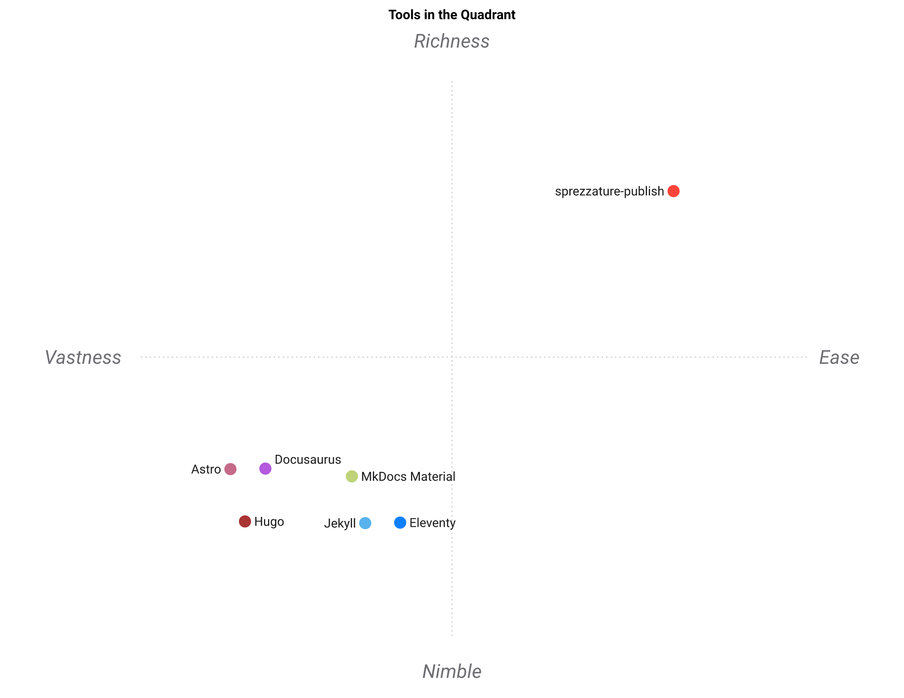

# Landscape

Most comparisons of site generators rank them, and the ranking hides the only
thing that decides anything: **how big is the site, and who is it for.**

A static-site generator built for a hundred versioned pages with a plugin
ecosystem is not a worse version of this package; it is a different tool, and
for that site it is the right one. `sprezzature-publish` is sized for a site
you can hold in your head — a README, some docs, a blog — and everything it
does well follows from that constraint.

## The honest table

These are **judgements**, not measurements: a 5 means "this is a strength of
that tool as of October 2026", a 1 means "it does not really do this". They
are written down so somebody can disagree with a specific number rather than
with a feeling.

| Tool | Setup simplicity | Scale of site | Built-in meta & indexes | Runs fully offline | Narration & read-along | Ecosystem size |
|---|---|---|---|---|---|---|
| **sprezzature-publish** | 5 | 2 | 5 | 5 | 5 | 1 |
| MkDocs Material | 4 | 5 | 3 | 4 | 1 | 4 |
| Hugo | 2 | 5 | 2 | 4 | 1 | 5 |
| Astro | 2 | 5 | 3 | 4 | 1 | 5 |
| Jekyll | 3 | 4 | 2 | 4 | 1 | 4 |
| Eleventy | 3 | 4 | 2 | 4 | 1 | 3 |
| Docusaurus | 2 | 5 | 3 | 4 | 1 | 4 |

The source lives in [`assets/landscape.csv`](assets/landscape.csv).

## The map



Produced with [`standpoint`](https://github.com/warith-harchaoui/standpoint)
from the table above:

```sh
standpoint assets/landscape.csv --outdir assets
```

The geometry is ordinary correlation PCA and is **deterministic** — the same
table gives the same map every run, whatever model named the axes. Two axes
carry about **95 %** of the information in the table, which is unusually high
and means the six criteria are not independent: tools that are easy to set up
here also tend to be the ones with small ecosystems.

Read it as a summary, not as evidence. The map faithfully projects the table;
the table is a set of opinions. `standpoint` will also write an interpretation
in prose — it is not reproduced here, because a model reading back ratings
somebody wrote is not a finding, and this file is more useful if the
judgements stay visibly mine.

## What the shape actually says

**The trade is scale against everything else.** The three criteria this
package scores highest on — meta and indexes built in, fully offline,
narration — are all things a small site wants and a large one solves with
plugins. The one it scores lowest on, ecosystem size, is the thing a large
site cannot do without.

**Narration is the only column where the field is empty.** Every other tool
scores 1, and not because they are behind: reading a page aloud with a timed
track that highlights the sentence being spoken is not a site-generator
feature anywhere else. That column is why this package exists beside the
others rather than instead of them.

**"Runs fully offline" is nearly flat**, and that flatness is honest. Most
generators run offline. What differs is whether the *meta tags and the plain
language rewrite* do, and here they do — the model is local.

## When to pick something else

- **A hundred versioned pages, a plugin ecosystem, a team** — MkDocs
  Material, Docusaurus, Astro. They are better at that and this package says
  so in its own README.
- **Raw build speed over everything** — Hugo.
- **An existing Jekyll site** — leave it there.
- **You want a hosted editor** — this is the wrong family entirely.

## See also

- [`speaker-helper`](https://github.com/warith-harchaoui/speaker-helper) — the
  voice this package orchestrates but does not own.
- [`sprezzature-accessibility`](https://github.com/warith-harchaoui/sprezzature-accessibility)
  — whether the page it produced is usable.
